# Báo cáo khai phá kho văn bản Phật giáo tiếng Việt
_Sinh tự động lúc 2026-11-02 11:31 bởi `python -m pipeline mine`_

## 1. Thống kê kho văn bản
| Chỉ số | Giá trị |
|---|---|
| Số văn bản | 384 |
| Số từ (token) | 591,672 |
| Kích thước từ vựng | 30,897 |
| Type/Token ratio | 0.0522 |
| Tỉ lệ từ ghép trong từ vựng | 0.8216 |
| Độ dốc Zipf | -1.192 |

### Theo nguồn
| Nguồn | Văn bản | Ký tự | Số từ TB |
|---|---|---|---|
| daophatngaynay | 94 | 1,837,209 | 1639.8 |
| langmai | 100 | 1,068,981 | 1379.6 |
| phatgiao | 99 | 976,090 | 1085.4 |
| vbeta | 91 | 2,124,084 | 2111.2 |

### Theo chủ đề
| Chủ đề | Văn bản | Ký tự |
|---|---|---|
| Kinh điển | 214 | 4,167,460 |
| Phật học và triết học | 98 | 1,139,474 |
| Thiền và tu tập | 25 | 266,086 |
| Lịch sử và văn hóa | 22 | 124,290 |
| Đức Phật và chư Tổ | 9 | 87,800 |
| Đời sống | 8 | 85,418 |
| Tin tức Giáo hội | 6 | 33,296 |
| Khác | 2 | 102,540 |

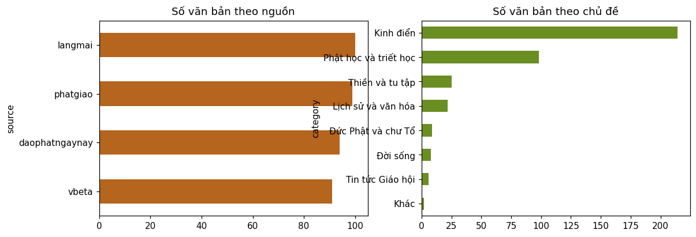
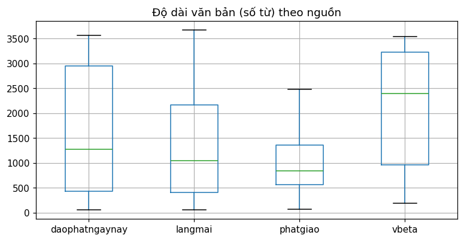
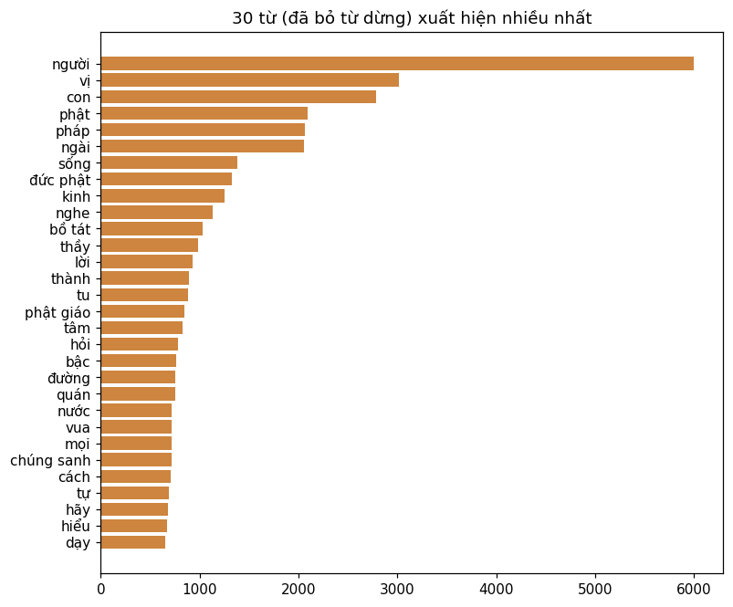
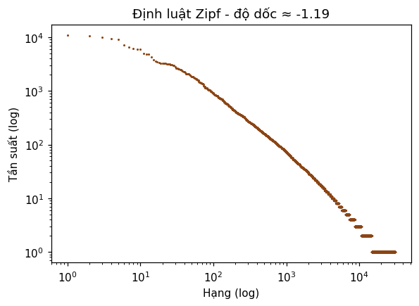

**Từ ghép phổ biến:** đức phật, bồ tát, phật giáo, chúng sanh, thế giới, con người, giải thoát, bất khả thuyết, nhà vua, thực tập, trí tuệ, hạnh phúc, tu tập, khổ đau, thanh tịnh, tỳ khưu, khả năng, bạch thế tôn, câu chuyện, trở thành, việt nam, đệ tử, thế gian, vô thường, chánh niệm

**Cụm 2 từ phổ biến:** con đường, cúng dường, tu bậc, mọi người, con trai, người con, hơi thở, vị khất sĩ, chuyển hóa, quán chiếu, đảnh lễ, phật dạy, vị tỳ khưu, vị tu, bát nhã ba la mật, kinh phật, lời dạy, kể câu chuyện, người người, người tu

## 2. Trích xuất từ khóa (TF-IDF)
| Chủ đề | Từ khóa đặc trưng |
|---|---|
| Khác | living, pháp thoại, kiều, sư ông, lưu trữ, thực tập, kho tàng, ngôn ngữ, sưu tập, thúy kiều, sống động, yểm trợ |
| Kinh điển | kinh, phật, đức phật, ngài, bậc, thành, bồ tát, loại, dịch, kia, hỏi, bụt |
| Lịch sử và văn hóa | chợt, bản văn xuôi, phỏng, sáng tạo, đầu, ngô tằng giao, chi, thi hóa, đường, thay, tâm minh, vội |
| Phật học và triết học | phật giáo, tứ, giúp, tâm, tài liệu, con người, tầm, cách, khả năng, hiểu, phật, thuật ngữ |
| Thiền và tu tập | thiền, nhận biết, cơ thể, cuộc sống, hãy, khả năng, phật giáo, nỗi, thở, chánh niệm, trở thành, mọi |
| Tin tức Giáo hội | giáo hội, đại biểu, hội đồng trị sự, trung ương, tổ chức, đại hội, toàn quốc, chương trình, chùa, phật giáo, công tác, việt nam |
| Đời sống | viết, giữ, chùa, đức phật, nhìn, chuyện, chúng sinh, lòng, kể, bản, phật, đọc |
| Đức Phật và chư Tổ | đức phật, phật, đản sinh, ngài, điên, lịch sử, tìm, chúng sinh, giáo pháp, thái tử, hiện hữu, đức |

### Ví dụ từ khóa của từng văn bản
| Văn bản | Từ khóa |
|---|---|
| Angulimala: từ kẻ sát nhân hàng loạt trờ thành vị thánh | angulimala, vũ khí, ngón, nhà sư, lấp lánh, dừng, khóa học, phụ nữ |
| Đại Tỳ-bà-sa luận (大毗婆沙论 Abhidharma-mahavibhasa-sastra) | túc luận, kiền độ, phát trí luận, nhất thiết hữu bộ, quyển, tâm luận, dị thuyết, luận |
| Bài kinh ca ngợi Bụt Amitabha | mô bụt, amitabha, tịnh độ, cam, an lành, làm nên, đại địa, như lai |
| Ái ngữ lắng nghe | mau chóng, truyền thông, ái ngữ, bực bội, lắng nghe, con nguyện, thực tập, hàm ý |
| Bồ tát vô úy | quảng độ, tử thần, sống chết, nhà nước, hèn nhát, tiên, vô úy, độc tài |
| Cách chép kinh Vu lan báo hiếu tại nhà | chép kinh, kinh vu lan, chép, báo hiếu, kinh văn, sạch sẽ, hiếu, bút |
| Đại hội Phật giáo toàn quốc lần thứ X có những hoạt động gì? | giáo hội, triển lãm, chào mừng, đại hội, toàn quốc, văn phòng, đại biểu, dự kiến |
| Luật Ma Ha Tăng Kỳ - Tập 1 - Quyển Thứ Ba : Phần Còn lại Của Giới Trộm | ăn trộm, xóm làng, mỡ, trục xuất, sữa, ranh giới, ngu, tử hình |

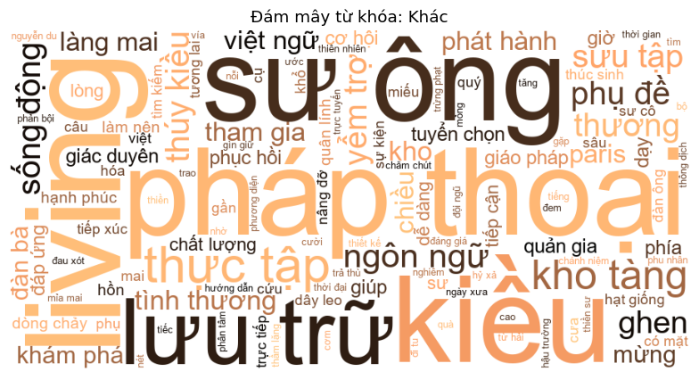
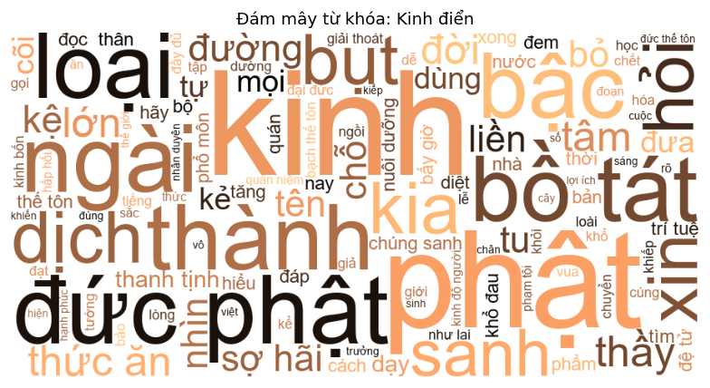
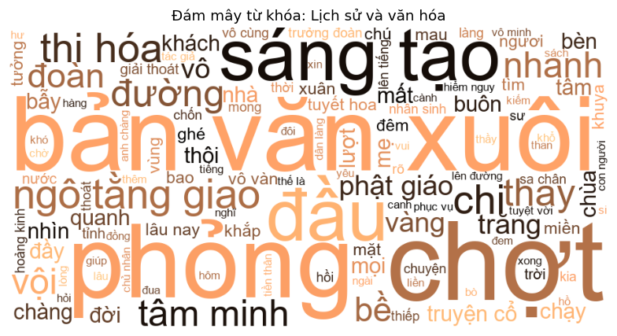
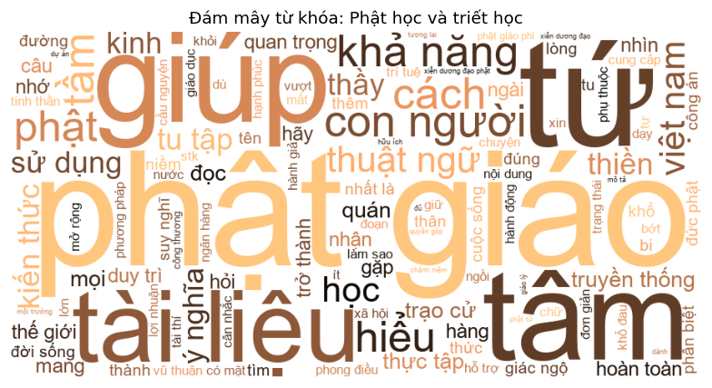
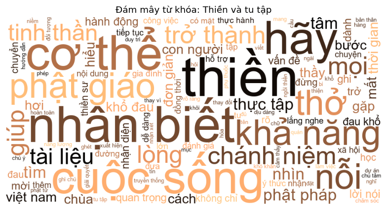
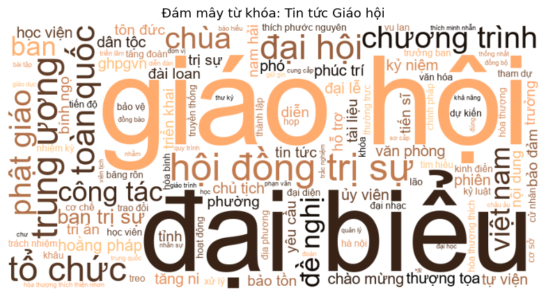
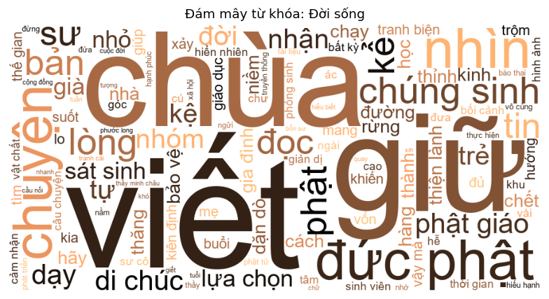
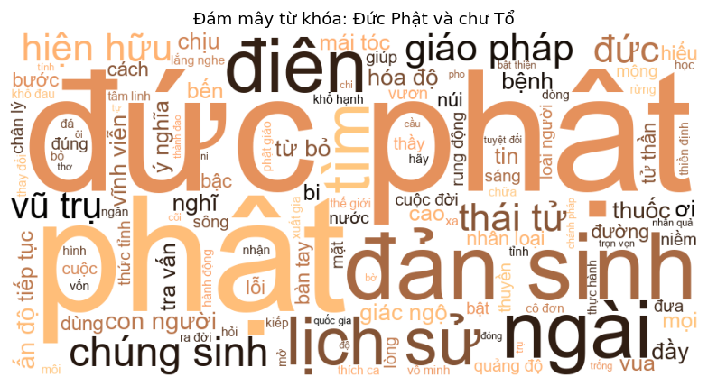

## 3. Mô hình chủ đề LDA (10 topic, perplexity = 2132.57)
| Topic | Tỉ trọng | Từ tiêu biểu | Văn bản tiêu biểu |
|---|---|---|---|
| T0 | 0.0685 | sợ hãi, thức ăn, nuôi dưỡng, phổ môn, yếu tố, nhận thức, cha mẹ, trưởng, giả, mở | Kinh Bách Dụ: Thay mũi cho vợ; Quỷ Trong Sa Mạc |
| T1 | 0.0935 | ngài, bất khả thuyết, dịch, đức phật, bộ, bản, câu, hoa, đệ tử, chữ | Đại Tỳ-bà-sa luận (大毗婆沙论 Abhidharma-maha; Lược giải Kinh Pháp Hoa - 2. Lịch Sử Kin |
| T2 | 0.1085 | tăng, tầm, tứ, gặp, ngồi, cúng, suy nghĩ, bà, lễ, dường | Những công năng khi trì niệm Chú Dược Sư; Kiết sử trao cử là gì? |
| T3 | 0.0944 | sư, trà, nước, viết, thầy, chùa, cây, đọc, nhà, đưa | Kinh Tăng Chi Bộ 1 - Chương I Một Pháp I; Video books Kinh Tiểu Bộ_Tập (4,5)/10 |
| T4 | 0.1123 | bồ tát, chúng sanh, ngài, tu, rõ, vô, ba la mật, tướng, vô lượng, dẫn | Kinh Lương Hoàng Sám (Quyển 9); Luận Đại Trí Độ Tập II - Quyển 25. Phẩm  |
| T5 | 0.0466 | tỳ khưu, phạm tội, tu, quán, bậc, ngươi, bỏ, sanh, ngã, lìa | Phân tích giới Tỳ khưu (Tập 1) - Điều Pā; Phân Tích Giới Tỳ Khưu Tập 2 - 6.1.2. Đi |
| T6 | 0.0978 | đức phật, ngài, vua, nhà vua, câu chuyện, nhận, kể, bà, lòng, trở | Bản Sanh: truyện 501 tới 510 / Jataka Ta; Bản Sanh: truyện 471 tới 480 / Jataka Ta |
| T7 | 0.0785 | bạch thế tôn, thời, thế tôn, loại, vua, hỏi, thầy, diệt, chánh, đại đức | Kinh Trường Bộ 2 - 17. Kinh Đại Thiện Ki; Kinh Tương Ưng 5 Đại Phẩm - Chương I Tươ |
| T8 | 0.0915 | phật giáo, con người, chùa, việt nam, đức phật, xã hội, học, đạo phật, giáo hội, giác ngộ | Chùa Làng, Chùa Thị; Phật giáo trong biến đổi xã hội ở Trung  |
| T9 | 0.2083 | thầy, thực tập, thở, mẹ, bụt, giúp, chánh niệm, hạnh phúc, bước, ý thức | Chánh niệm là nền tảng cho những hành độ; Bài học đầu tiên về thực tập chánh niệm |

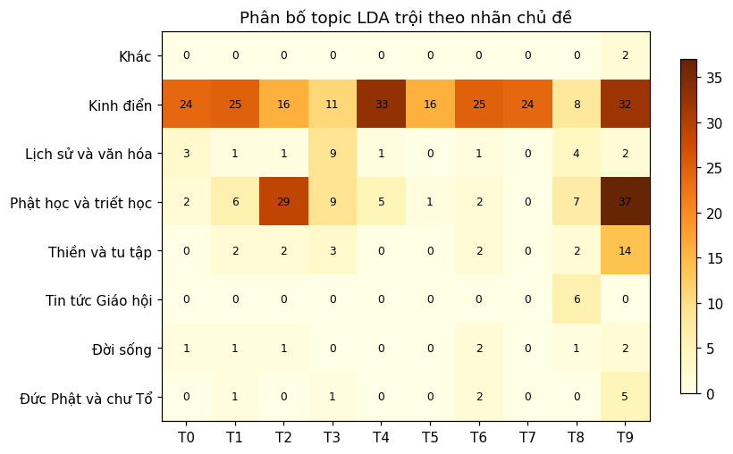

## 4. Phân cụm văn bản (K-Means trên LSA, k=8)
Silhouette = **0.0651**, ARI so với nhãn chủ đề = **0.0905**, NMI = **0.207**

| Cụm | Số VB | Chủ đề chính | Từ đặc trưng |
|---|---|---|---|
| 0 | 91 | Kinh điển | phạm tội, tâm, đưa, bậc, thầy, kinh, tỳ khưu, kẻ |
| 1 | 49 | Phật học và triết học | phật giáo, tài liệu, việt nam, truyền thống, hỗ trợ, giáo dục, khả năng, mở rộng |
| 2 | 33 | Kinh điển | ngài, duy thức, thức, dịch, bộ luận, thành, đại thừa, ngã |
| 3 | 73 | Phật học và triết học | bụt, thực tập, có mặt, thầy, thở, xin, hạnh phúc, mẹ |
| 4 | 51 | Kinh điển | đức phật, ngài, vua, kể, câu chuyện, nhà vua, sư, trai |
| 5 | 29 | Kinh điển | phổ môn, kinh bốn, hấp hối, kinh độ người, khiếp, sợ hãi, thức ăn, kinh |
| 6 | 37 | Kinh điển | chúng sanh, bồ tát, sanh, phật, vô lượng, tướng, ba la mật, thế gian |
| 7 | 21 | Phật học và triết học | kiến thức, phong điều, vũ thuận, tứ, công án, trạo cử, tầm, thuật ngữ |

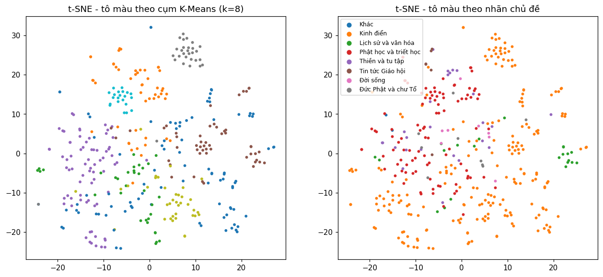
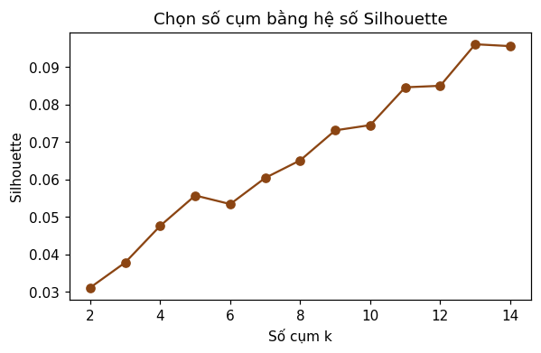

## 5. Phân loại văn bản
### Bài toán: dự đoán `category` (359 văn bản, 4 lớp)
| Mô hình | CV macro-F1 | Test macro-F1 |
|---|---|---|
| Naive Bayes | 0.3619 ± 0.0533 | 0.3353 |
| Logistic Regression | 0.6383 ± 0.0923 | 0.7327 |
| Linear SVM | 0.6254 ± 0.0911 | 0.7229 |

Mô hình tốt nhất: **Logistic Regression**

| Lớp | Precision | Recall | F1 | Support |
|---|---|---|---|---|
| Kinh điển | 0.872 | 0.953 | 0.911 | 43 |
| Lịch sử và văn hóa | 1.0 | 0.75 | 0.857 | 4 |
| Phật học và triết học | 0.81 | 0.85 | 0.829 | 20 |
| Thiền và tu tập | 1.0 | 0.2 | 0.333 | 5 |

- **Kinh điển**: vị, bậc, dịch, loại, khất sĩ, kệ, bạch thế tôn, thế tôn, kinh, quán niệm
- **Lịch sử và văn hóa**: sáng tạo, tuyết hoa, trăng, lượt, bản văn xuôi, phỏng, ngô tằng giao + thi hóa, thi hóa, tâm minh + ngô tằng giao, ngô tằng giao
- **Phật học và triết học**: làm sao, giúp, ý nghĩa, tứ, nhớ, nhất là, tầm + tứ, sư ông, phật giáo + thức, tết
- **Thiền và tu tập**: thiền, nhận biết, cơ thể, phật pháp + cuộc sống, thiền sư, thiền phái, thực hành + chánh niệm, chạm, đừng + đợi, thiên nhiên

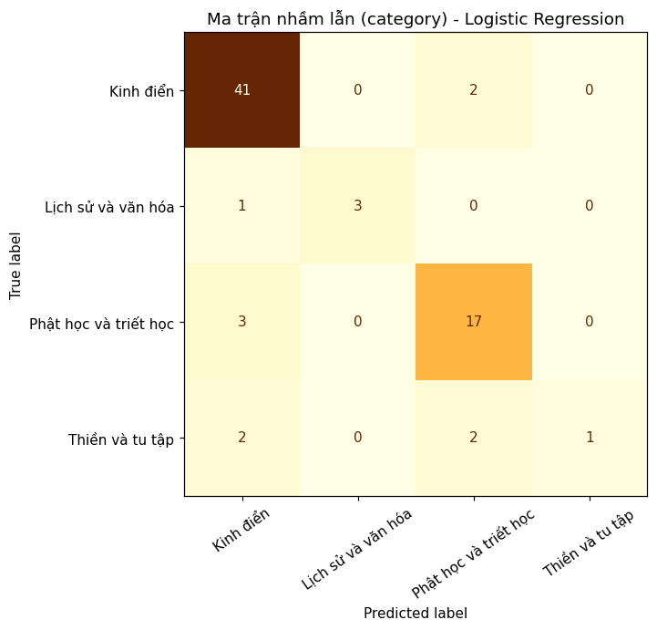

### Bài toán: dự đoán `source` (384 văn bản, 4 lớp)
| Mô hình | CV macro-F1 | Test macro-F1 |
|---|---|---|
| Naive Bayes | 0.9203 ± 0.0164 | 0.9216 |
| Logistic Regression | 0.9345 ± 0.0179 | 0.9352 |
| Linear SVM | 0.9472 ± 0.0166 | 0.9352 |

Mô hình tốt nhất: **Logistic Regression**

| Lớp | Precision | Recall | F1 | Support |
|---|---|---|---|---|
| daophatngaynay | 0.947 | 0.947 | 0.947 | 19 |
| langmai | 1.0 | 0.95 | 0.974 | 20 |
| phatgiao | 1.0 | 0.85 | 0.919 | 20 |
| vbeta | 0.818 | 1.0 | 0.9 | 18 |

- **daophatngaynay**: đức phật, video, ngài, bản, nhà sư, dịch, nhân sinh, viết, tâm minh, tâm minh + ngô tằng giao
- **langmai**: bụt, thực tập, có mặt, làng mai, thầy, khất sĩ, đạo bụt, mọi + loài, vị + khất sĩ, tuệ giác
- **phatgiao**: tài liệu, phật giáo, hỗ trợ, truyền thống + phật giáo, quyên góp + hàng, dự án + hoàn toàn, duy trì + mở rộng, giáo dục + phật giáo phi, ngân hàng + công thương, hãy + cân nhắc
- **vbeta**: phạm tội, lợi ích, bạch thế tôn, thế tôn, tỳ khưu, ví như, nay, sanh, bấy giờ, pháp + đưa

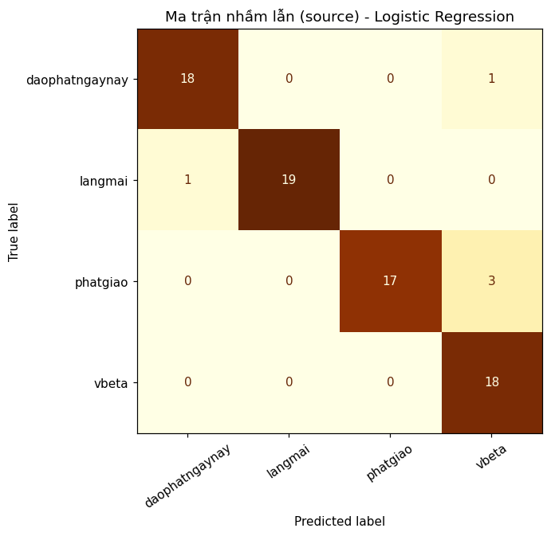

## 6. Nhận dạng thực thể (mẫu 150 văn bản)
| Loại | Thực thể phổ biến |
|---|---|
| PER | Ngài (147), Đức Phật (145), Phật (125), Bụt (85), Tỳ-kheo (62), Như Lai (44), Xá Lợi Phất (42), Kinh (38), Bồ Tát (38), Tuân (31), Tỷ-kheo (31), Thích Minh Châu (31), Ch (30), Tâm (29), Bồ Tát Quan Thế Âm (26) |
| LOC | Pháp (113), các Tỷ-kheo (109), Việt Nam (57), NHAU XIỂN DƯƠNG ĐẠO PHẬT (31), HT (31), Ph (30), | Video Books Kinh Tăng Chi Bộ (29), tài thí Xiển dương Đạo Pháp (28), Tỷ-kheo (25), Việt (23), tiếng Việt (20), ngài Thế Thân (20), ông già Noel (20), Phật (18), Trung Quốc (14) |
| ORG | A Nan (10), Ngài (4), Phật (3), Tây Tạng (2), Đức Phật (2), Nan-đà (2), Vacchagotta (1), Thiện Siêu (1), Living Buddha (1), Kinh Duy Ma Cật (1), Ma (1), Tâm Kinh (1), Đức (1), Thiền (1), Đại Học Princeton (1) |

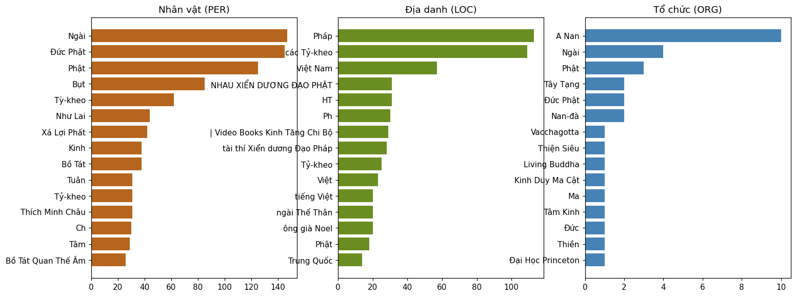
